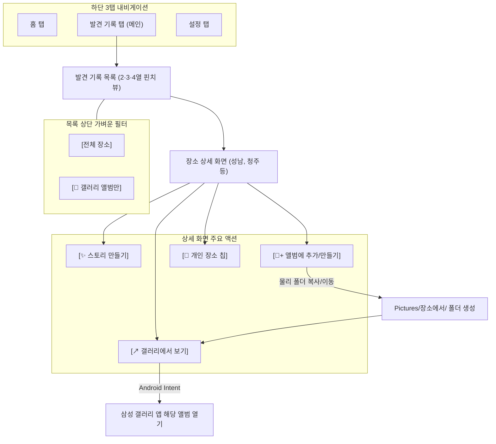

# PhotoPlace — 발견 기록 중심 3탭 전환 및 갤러리 연동 설계안 (Design Specification)

> **문서 상태**: 검토용 초안 (Draft for User & Codex Review)  
> **작성일자**: 2026-11-22  
> **관련 문서**: [WORKLOG_2026-11-22.md](WORKLOG_2026-11-22.md), [DESIGN_Personal_Place_GPS_2026-11-15.md](DESIGN_Personal_Place_GPS_2026-11-15.md), [UI_GUIDE.md](UI_GUIDE.md)

## Codex 검토 후 사용자 확정 및 구현 범위 (2026-11-22)

- 사용자가 3탭 + 발견 기록의 전체/위치 앨범 통합을 승인했고, 추가 질문에서 ‘이번에 발견 기록 상세·뷰어도 함께 사용’을 선택했다.
- 전체는 기존 MemoryRepository 통합 목록을 재사용하며 기존 연결 근거가 있는 장소만 병합한다. 이름만으로 새 병합을 추가하지 않는다. 위치 앨범 필터는 기존 실제 앨범 목록·이름을 유지한다.
- 위치 앨범 필터의 카드는 공통 상세·사진/동영상 뷰어를 사용하되 해당 폴더의 미디어만 전달한다. 스토리·날짜 메모·개인 장소 기능은 공통 컴포넌트를 재사용한다. 앨범 관리는 기존 관리 화면 진입을 남긴다.
- 기존 MainActivity.openAlbumInSamsungGallery는 이미 bucket ID + SHORTCUT_ALBUM_VIEW + GalleryExternalActivity로 특정 앨범 진입을 시도하고 일반 갤러리로 폴백한다. 사용자 지적 후 확인했으며, 아래 초안 4.2의 대표 사진 ACTION_VIEW 방식으로 교체하지 않는다. 삼성 실기기 호환성 확인은 여전히 필요하다.
- 이번에는 코드 수정/디버그 테스트까지만 수행한다. 사용자 실기기 확인 전 출시하지 않는다. 스토리 선명도 후속 개선은 별도 이월 항목이다.
- 상세 근거 및 한계: [Codex 리뷰](REVIEW_Discovery_Centric_Navigation_2026-11-22.md).

---

## 1. 배경 및 목표 (Background & Goals)

### 1.1 배경
- **초기 목적(V1)**: 남편("우리아저씨")의 실제 필요에서 출발하여, 기기 저장소(`Pictures/<장소명>에서/`)에 실제 폴더를 만들고 사진을 물리적으로 분류하는 '위치 앨범'이 중심이었습니다.
- **현재 상황(V2)**:
  - 사진을 물리적으로 이동하지 않고도 실시간 위치 기반으로 묶어주는 **`발견 기록`**이 완성되었습니다.
  - 고화질 인앱 **PhotoViewer** 및 **VideoViewer**, **날짜별 메모/일기**, **개인 장소(우리집/회사/단골카페)**, **인스타그램 스토리 고화질 제작/공유(2160px)**까지 앱 안에서 완결되는 경험이 구축되었습니다.
- **문제점**:
  - 하단에 `[홈]`, `[발견 기록]`, `[위치 앨범]`, `[설정]` 4개 탭이 공존하면서, 사용자는 `발견 기록`과 `위치 앨범`이 사실상 같은 장소 카드들을 중복해서 보여주는 혼란(예: `청주` vs `청주에서`)을 겪게 됩니다.
  - 앱의 주력 사용성이 '물리 폴더 이동'에서 '비파괴적 위치 기록 탐색 및 스토리 공유'로 전환되었음에도 하단 메인 탭 1자리를 '위치 앨범'이 계속 차지하고 있습니다.

### 1.2 목표
1. **하단 메인 탭을 3개로 슬림화 (`[홈] [발견 기록] [설정]`)**: 탭 간섭을 없애고 직관성을 극대화.
2. **원래 핵심 니즈(남편의 물리 앨범 생성) 100% 보존**:
   - 상세 화면의 `[📁+ 앨범 만들기 / 추가]` 액션을 유지하여 원할 때 언제든 실물 폴더 앨범 생성 가능.
3. **'삼성 갤러리 앱 원탭 점프(`[갤러리에서 보기 ↗]`)' 제공**:
   - 이미 만들어진 물리 앨범이 있는 장소는 버튼 터치 1번으로 삼성 갤러리 해당 폴더로 직행하여 볼 수 있도록 지원.
4. **발견 기록 내 '📁 정리된 앨범만' 필터 지원**:
   - 기존 '위치 앨범' 탭처럼 정리된 앨범들만 모아서 보고 싶은 사용자도 1탭으로 필터링 가능.

---

## 2. 사용자 경험 및 진입 동선 (UX Flow)



---

## 3. 화면 UI 구조 (Wireframe)

### 3.1 발견 기록 메인 화면 (3탭 적용 & 가벼운 필터)

```text
┌──────────────────────────────────────────┐
│  PhotoPlace                              │
│  발견 기록                [ 🔍 ]  [ ⋮ ]  │
│                                          │
│  [ 전체 28 ]  [ 📁 갤러리 앨범만 12 ]    │  <-- 상단 서브 필터 (원터치 전환)
├──────────────────────────────────────────┤
│  ┌──────────────────┐  ┌───────────────┐ │
│  │ [ 대표 사진 ]    │  │ [ 대표 사진 ] │ │
│  │                  │  │               │ │
│  │ 성남             │  │ 수원          │ │
│  │ 📍 우리집 18     │  │ 📍 회사 462   │ │
│  │ 📁 갤러리 앨범   │  │ 📁 갤러리 앨범│ │  <-- 정리된 앨범이 있으면 뱃지 표시
│  └──────────────────┘  └───────────────┘ │
│  ┌──────────────────┐  ┌───────────────┐ │
│  │ [ 대표 사진 ]    │  │ [ 대표 사진 ] │ │
│  │ 청주             │  │ 종로구        │ │
│  │ 사진 24장        │  │ 사진 8장      │ │
│  └──────────────────┘  └───────────────┘ │
├──────────────────────────────────────────┤
│    [ 🏠 홈 ]    [ 🖼 발견 기록 ]  [ ⚙ 설정 ] │  <-- 3개로 깔끔해진 하단 탭
└──────────────────────────────────────────┘
```

### 3.2 발견 상세 화면 (갤러리 원탭 점프 & 앨범 액션)

```text
┌──────────────────────────────────────────┐
│  [←]  성남                        [ ⋮ ]  │
│  2026.10.15 ~ 2026.11.15 · 총 63장      │
├──────────────────────────────────────────┤
│  ┌─────────────────────────────────────┐ │
│  │ 📁 갤러리 앨범 '성남에서' 정리됨    │ │
│  │ 45장이 기기 앨범 폴더에 있어요       │ │
│  │                                     │ │
│  │ [ 갤러리에서 보기 ↗ ] [ 앨범에 추가 ]│ │  <-- 남편분을 위한 원탭 점프 버튼!
│  └─────────────────────────────────────┘ │
│                                          │
│  [ 전체 63 ] [ 📍 우리집 18 ] [ 나머지 ] │  <-- 개인 장소 칩
├──────────────────────────────────────────┤
│  [사진]  [사진]  [사진]                   │
│  [사진]  [사진]  [사진]                   │
│  ...                                    │
├──────────────────────────────────────────┤
│  선택 2장          [ ✨ 스토리 공유 ]     │  <-- 인스타 스토리 연동
└──────────────────────────────────────────┘
```

---

## 4. 상세 기능 명세 (Feature Specifications)

### 4.1 하단 내비게이션 바 (`BottomNavigationRenderer`)
- 기존: `{"홈", "발견 기록", "위치 앨범", "설정"}` (4탭)
- 변경: `{"홈", "발견 기록", "설정"}` (3탭)
- 아이콘: `home`, `photoLibrary`, `settings`
- 장점:
  - 탭 1개당 터치 영역 확보 (48dp 이상 여유)
  - 텍스트 말줄임 및 오밀조밀한 느낌 해소
  - 폰트 가독성 및 정렬 개선

### 4.2 삼성 갤러리 앱 원탭 점프 (`JumpToGalleryHelper`)
- **트리거**: 상세 화면 내 `[ 갤러리에서 보기 ↗ ]` 버튼 터치
- **동작**:
  1. 정리된 앨범의 대표 미디어 `Uri` 또는 폴더 경로(`Pictures/장소에서/`) 취득
  2. 삼성 갤러리(`com.sec.android.gallery3d`) 명시적 인텐트 우선 호출:
     ```java
     Intent intent = new Intent(Intent.ACTION_VIEW);
     intent.setDataAndType(albumMediaUri, "image/*");
     intent.setPackage("com.sec.android.gallery3d");
     ```
  3. 삼성 외 기기이거나 미설치 시 시스템 기본 갤러리 `ACTION_VIEW` 폴백.
- **안전성**: 외부 앱 호출 실패 시에도 안내 토스트(`"갤러리 앱을 열지 못했어요"`) 후 앱 크래시 없음.

### 4.3 발견 기록 내 갤러리 앨범 표시 & 서브 필터
- **카드 배지**: `record.hasGalleryAlbum` (또는 `record.sourceType == MIXED || ORGANIZED_ALBUM`)인 경우 카드 우측 하단 또는 메타 행에 연한 라벤더 톤의 `📁 앨범` 배지 표시.
- **서브 필터**:
  - `[ 전체 N ]`: 기존과 동일하게 모든 발견 장소 표시.
  - `[ 📁 갤러리 앨범만 M ]`: 실제 폴더로 정리 완료된 장소들만 필터링 (기존 '위치 앨범' 탭과 100% 동일한 탐색 경험 제공).

---

## 5. 영향도 및 원칙 검증

1. **P0 Gatekeeper (`AGENTS.md`)**:
   - `MainActivity.java`에 비즈니스 로직 0줄 추가.
   - `BottomNavigationRenderer.java`, `MemoryBrowserState.java`, `DiscoverySnapshotController.java`, `GalleryJumpHelper.java` 등 전용 렌더러/도우미 클래스로 분리 격리.
2. **P1 Data Safety**:
   - 파일 이동/삭제 일체 없음.
   - 읽기 전용 프로젝션 유지.
3. **사용자 경험 하위 호환성 (남편분의 사용 패턴)**:
   - "정리된 앨범을 보고 싶다" ➡️ 상단 필터 `[📁 갤러리 앨범만]` 누르면 즉시 해결.
   - "삼성 갤러리 앱에서 보고 싶다" ➡️ 장소 상세에서 `[갤러리에서 보기 ↗]` 누르면 1초 만에 점프.
