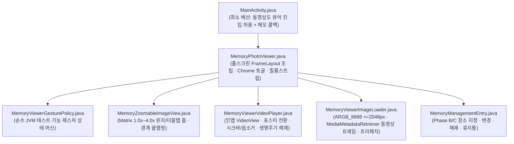

# PhotoPlace — 메모리 인앱 뷰어(사진 + 동영상) 고도화 설계안 V2.0 (Implementation-Ready Blueprint)

> **문서 상태**: V2.0 (실전 구현 청사진 — GPT 1차 리뷰 + **인앱 동영상(Video) 재생/프레임 추출/정리 고도화** 반영)
> **작성일자**: 2026-11-08
> **작성자**: Antigravity (Gemini)
> **핵심 원칙**:
> 1. **사진과 동영상 모두 앱 안에서 끊김 없이 감상·정리**: 그리드에서 동영상을 탭했을 때 외부 앱으로 튕기지 않고 인앱 뷰어([`MemoryPhotoViewer.java`](file:///C:/work/projects/PhotoPlace/app/src/main/java/com/example/gallerysorter/MemoryPhotoViewer.java))에서 즉시 프레임 프리뷰·인앱 재생·좌우 스와이프·장소 지정/휴지통 정리를 수행할 수 있게 한다.
> 2. **P0 아키텍처 원칙 준수**: [`MainActivity.java`](file:///C:/work/projects/PhotoPlace/app/src/main/java/com/example/gallerysorter/MainActivity.java)에는 새로운 비즈니스 로직(이미지/동영상 디코딩, 미디어 플레이어 제어, 제스처 판정, 상태 관리 등)을 절대 추가하지 않으며, 진입 배선(`memoryPhotoThumbnailRenderer`의 동영상 뷰어 진입 허용 및 메모 조회 콜백 전달)만 최소한으로 연결한다.
> 3. **Phase B/C 정리 액션 100% 재사용**: 사진과 동영상 모두 [`MemoryManagementEntry.openSingle(...)`](file:///C:/work/projects/PhotoPlace/app/src/main/java/com/example/gallerysorter/MemoryManagementEntry.java#L26)을 그대로 호출하여 장소 지정·변경·해제·일반 휴지통 이동을 공유한다.

---

## 0. 버전 히스토리 (V1.0 → V1.1 → V2.0 핵심 변경점)

- **V1.1 (GPT 리뷰 반영)**:
  1. `0ms 보장` 표현 제거 → 뷰포트 긴 변(`<= 2048px`) 다운샘플링 + `LruCache` 바이트 상한(`min(힙 1/8, 32MiB)`) 명세.
  2. 하단 미니 필름스트립을 상시 노출하지 않고 **Chrome(상·하단 컨트롤) 표시 상태와 동기화**.
  3. 확대 상태(`scale > 1.01f`)에서 세로 닫기(`DISMISS_VERTICAL`) 원천 잠금.
- **V2.0 (비디오(Video) 일급 시민 지원 & 직접 구현용 상세 설계)**:
  1. **그리드에서 동영상 탭 시 인앱 뷰어 진입 ([`MainActivity.java:9287`](file:///C:/work/projects/PhotoPlace/app/src/main/java/com/example/gallerysorter/MainActivity.java#L9287))**:
     - 기존에는 동영상을 탭하면 뷰어를 건너뛰고 즉시 외부 플레이어로 이탈했으나, 이제 사진과 동일하게 `showMemoryPhotoViewer(section, indexOfPhoto(section, item))`로 진입하여 사진·동영상을 연속으로 넘겨보고 정리할 수 있다.
  2. **동영상 포스터 프레임 디코딩 복원 (`MediaMetadataRetriever` 폴백 추가)**:
     - [`MemoryPhotoViewer.java:222-224`](file:///C:/work/projects/PhotoPlace/app/src/main/java/com/example/gallerysorter/MemoryPhotoViewer.java#L222-L224)의 `if (video) host.clearThumbnail(image)`를 제거하여 고화질 포스터 프레임을 표시한다.
     - [`MemoryViewerImageLoader.java:126-157`](file:///C:/work/projects/PhotoPlace/app/src/main/java/com/example/gallerysorter/MemoryViewerImageLoader.java#L126-L157)에서 `ContentResolver.loadThumbnail()`이 실패할 때 `BitmapFactory.decodeStream()`(동영상에서 항상 `null`)만 시도하던 한계를 고쳐, `MediaMetadataRetriever.getFrameAtTime()` 폴백으로 어떤 동영상 URI에서도 선명한 첫 프레임을 추출한다.
  3. **인앱 인라인 동영상 플레이어 (`MemoryViewerVideoPlayer`) 탑재**:
     - 외부 앱을 띄우지 않고 뷰어 안에서 바로 재생/일시정지(`▶`/`⏸`), 시크바(SeekBar + `00:12 / 01:05`), 음소거 토글(`🔊`/`🔇`)을 지원한다.
     - 코덱 미지원 등 재생 오류(`OnErrorListener`) 발생 시 또는 사용자가 `"외부 앱으로 열기"` 보조 버튼을 누를 때만 안전하게 `host.openExternal(item)`로 폴백한다.
     - 좌우 페이지 스와이프, 뷰어 닫기, `onDetachedFromWindow` 시 즉시 `stopPlayback()` 및 오디오 포커스/디코더 리소스를 해제하여 백그라운드 소리 누수를 원천 차단한다.

---

## 1. 현재 뷰어 및 동영상 경험의 7대 문제점 (Code-Level Diagnosis)

| # | 문제점 | 현재 코드 위치 | 사용자 체감 문제 |
|---|---|---|---|
| 1 | **그리드에서 동영상 탭 시 외부 앱 강제 이탈** | [`MainActivity.java:9287-9291`](file:///C:/work/projects/PhotoPlace/app/src/main/java/com/example/gallerysorter/MainActivity.java#L9287-L9291) | 동영상을 누르면 인앱 뷰어가 열리지 않고 외부 앱으로 튕겨, 앞뒤 사진과 함께 볼 수 없고 뷰어 내 `"정리"` 버튼도 쓸 수 없음 |
| 2 | **뷰어 내 동영상 포스터 강제 삭제 (검은 화면)** | [`MemoryPhotoViewer.java:222-224`](file:///C:/work/projects/PhotoPlace/app/src/main/java/com/example/gallerysorter/MemoryPhotoViewer.java#L222-L224) | 사진에서 옆 동영상으로 스와이프하면 `host.clearThumbnail(image)`가 호출되어 시꺼먼 빈 화면만 보임 |
| 3 | **인앱 동영상 재생기 부재** | [`MemoryPhotoViewer.java:93-100, 125-135`](file:///C:/work/projects/PhotoPlace/app/src/main/java/com/example/gallerysorter/MemoryPhotoViewer.java#L93-L135) | 짧은 클립 하나를 보려고 해도 매번 외부 플레이어 앱이 실행되어 감상 흐름이 끊김 |
| 4 | **동영상 프레임 폴백 디코더 누락** | [`MemoryViewerImageLoader.java:126-157`](file:///C:/work/projects/PhotoPlace/app/src/main/java/com/example/gallerysorter/MemoryViewerImageLoader.java#L126-L157) | `loadThumbnail` 실패 시 이미지 전용 `BitmapFactory.decodeStream`만 호출하여 동영상 썸네일 추출 실패 가능 |
| 5 | **핀치 줌(1x~4x) 및 더블탭 줌 부재** | [`MemoryPhotoViewer.java:88-92`](file:///C:/work/projects/PhotoPlace/app/src/main/java/com/example/gallerysorter/MemoryPhotoViewer.java#L88-L92) | 일반 `ImageView`(`FIT_CENTER`)만 사용하여 사진 확대 불가 |
| 6 | **화질 열화(`RGB_565`) 및 인접 프리페치 부재** | [`MemoryViewerImageLoader.java:151`](file:///C:/work/projects/PhotoPlace/app/src/main/java/com/example/gallerysorter/MemoryViewerImageLoader.java#L151) | 스트림 디코딩 시 `RGB_565` 고정으로 계조 손실이 발생하며, 인접 미디어 프리페치가 없음 |
| 7 | **고정 컨트롤의 화면 잠식 & 날짜 메모 단절** | [`MemoryPhotoViewer.java:53-132, 186-192`](file:///C:/work/projects/PhotoPlace/app/src/main/java/com/example/gallerysorter/MemoryPhotoViewer.java#L53-L132) | 상·하단 바가 화면을 상시 가리고, 원탭 Chrome 숨김 모드와 그날의 메모(`MemoryDateNote`) 표시가 없음 |

---

## 2. 화면 UI 및 인터랙션 설계 (Photo & Video Unified Wireframe)

### 2.1 사진(Photo) 감상 상태 (Chrome 표시 ON)
```text
+-------------------------------------------------------------------+
| [‹]  2026년 5월 14일 · 경복궁                      오후 3:24  3/18 |  <- 상단 오버레이 헤더
|      [📍 수동 지정됨] (manualAssigned == true 일 때만 뱃지 노출)   |
|                                                                   |
|                                                                   |
|                    ( 전체 화면 고화질 사진 뷰포트 )                |  <- MemoryZoomableImageView
|                  - 핀치 줌 (1.0x ~ 4.0x) & 더블탭 줌 (2.5x)       |     (ARGB_8888, <= 2048px)
|                  - 원탭 시 상·하단 Chrome 전체 부드럽게 숨김/표시  |
|                  - 1.0x에서 좌우 드래그 전환 / 아래로 쓸어 닫기    |
|                                                                   |
|  +-------------------------------------------------------------+  |
|  | 💬 "날씨가 정말 좋았던 날, 경회루 앞 산책"       [메모 수정] |  |  <- 하단 오버레이 패널 (Chrome 연동)
|  +-------------------------------------------------------------+  |   1) 날짜 메모 캡션 바
|   [썸1]  [썸2]  [[ 썸3(현재) ]]  [▶썸4]  [썸5]  [썸6]  [썸7]     |   2) 미니 필름스트립 (2개 이상일 때)
|   [   📍 이 사진 정리   ]             [  🖼 외부 갤러리 열기  ]    |   3) Phase B/C 연동 액션 바
+-------------------------------------------------------------------+
```

### 2.2 동영상(Video) 감상 및 인앱 재생 상태 (`MemoryViewerVideoPlayer`)
```text
+-------------------------------------------------------------------+
| [‹]  2026년 5월 14일 · 경복궁 (동영상)             오후 3:28  4/18 |  <- 상단 오버레이 헤더
|                                                                   |
|                                                                   |
|                 ( 인앱 동영상 뷰포트: 포스터 + VideoView )         |  <- 재생 전: 선명한 포스터 이미지
|                                                                   |     + 중앙 반투명 원형 ( ▶ ) 버튼
|                            ((  ▶ / ⏸  ))                          |  <- 재생 중: 인라인 VideoView 렌더링
|                                                                   |     + 화면 원탭 시 Chrome 및
|                                                                   |       재생 컨트롤 함께 토글
|  +-------------------------------------------------------------+  |
|  | [⏸]  00:08 ━━━━━━━●━━━━━━━━━━━━━━ 00:34          [🔊] [↗]  |  |  <- 동영상 전용 컨트롤 바 (VIDEO일 때만 노출)
|  +-------------------------------------------------------------+  |     - 재생/일시정지, SeekBar, 음소거(🔊/🔇), 외부앱(↗)
|  | 💬 "경회루 연못 물결 소리"                       [메모 수정] |  |  <- 날짜 메모 캡션 바
|  +-------------------------------------------------------------+  |
|   [썸1]  [썸2]  [썸3]  [[ ▶썸4(현재) ]]  [썸5]  [썸6]  [썸7]     |  <- 미니 필름스트립 (동영상은 ▶ 배지 표시)
|   [  📍 이 동영상 정리  ]             [ 🎬 외부 플레이어 열기 ]    |  <- Phase B/C 정리 액션 100% 동일 동작
+-------------------------------------------------------------------+
```

---

## 3. 컴포넌트별 상세 기술 설계 (Class Architecture & Contracts)

`MainActivity.java` 비대화를 막기 위해 뷰어 기능은 아래 **5개의 응집도 높은 패키지 전용 클래스**로 모듈화한다.



### 3.1 [`MemoryViewerImageLoader.java`](file:///C:/work/projects/PhotoPlace/app/src/main/java/com/example/gallerysorter/MemoryViewerImageLoader.java) — 화질 개선, 동영상 프레임 추출, 인접 프리페치
1. **메모리 안전 `ARGB_8888` 디코딩**:
   - `requestedSize`를 `Math.min(requestedSize, 2048)`로 캡핑하여 12MP~200MP 원본도 장당 최대 8~12MiB 이내로 디코딩한다.
   - `images` `LruCache` 크기를 `Math.min((int) (Runtime.getRuntime().maxMemory() / 8), 32 * 1024 * 1024)`로 설정한다.
   - `options.inPreferredConfig = Bitmap.Config.ARGB_8888;`을 기본으로 사용하되, `OutOfMemoryError` 발생 시 `images.evictAll()` 후 `Bitmap.Config.RGB_565` 및 `inSampleSize * 2`로 안전하게 재시도한다.
2. **동영상 포스터 프레임 추출 폴백 (`decodeVideoFrame`)**:
   - `ContentResolver.loadThumbnail(uri, new Size(size, size), cancellation)`이 성공하면 즉시 반환한다.
   - 만약 `loadThumbnail`이 예외를 던지거나 `null`을 반환할 때 대상이 동영상(`mimeType.startsWith("video/")` 또는 스트림 헤더)이면, `MediaMetadataRetriever`를 열어 `getScaledFrameAtTime(-1L, MediaMetadataRetriever.OPTION_CLOSEST_SYNC, size, size)`(API 27+)로 대표 프레임을 추출하고 `finally`에서 반드시 `retriever.release()`를 호출한다.
3. **비경합 인접 1장 프리페치 (`prefetchAdjacent(List<MemoryPhotoItem> items, int currentIndex, int size)`)**:
   - 현재 사진/동영상 포스터 로드가 완료된 콜백(`transition.ready(bitmap)`) 시점에만 워커 큐에 `currentIndex + 1` → `currentIndex - 1` 순서로 프리페치 작업을 넣는다.
   - 사용자가 빠르게 연속 스와이프하면 `requests.cancel()`이 이전 디코딩과 프리페치를 즉시 취소(`CancellationSignal`)하여 최신 인덱스만 디코딩한다.

### 3.2 `MemoryViewerVideoPlayer.java` (신규) — 인앱 동영상 재생 및 리소스 생명주기 관리
외부 라이브러리 의존성 없이 Android 표준 `VideoView` + `MediaPlayer`를 감싼 경량 컨트롤러로 구현한다.

1. **상태 전이 (`IDLE_POSTER` → `PREPARING` → `PLAYING` ⇄ `PAUSED` / `ERROR_FALLBACK`)**:
   - **`IDLE_POSTER` (동영상 항목 진입 직후 기본 상태)**:
     - `MemoryZoomableImageView`에 고화질 동영상 포스터 프레임을 표시하고, 중앙에 64dp 원형 `▶` 재생 버튼을 띄운다. (사용자가 스와이프만 해서 지나갈 때 디코더를 불필요하게 열지 않아 스와이프 속도가 사진만큼 빠름!)
   - **`PREPARING` & `PLAYING` (사용자가 중앙 `▶` 또는 하단 컨트롤 바의 `▶` 탭 시)**:
     - `VideoView`를 `VISIBLE`로 전환하고 `setVideoURI(uri)` 호출.
     - `setOnPreparedListener`: 첫 프레임 렌더링 준비가 끝나면 포스터 이미지를 숨기고(`alpha 0`), `SeekBar` 최대값(`durationMs`)을 설정한 뒤 재생 시작 + 250ms 주기 `Handler`로 진행 시간(`00:08 / 00:34`)을 업데이트한다.
     - **음소거 토글(`🔊` / `🔇`)**: `MediaPlayer` 참조를 보관하여 `mediaPlayer.setVolume(0f, 0f)` / `setVolume(1f, 1f)`로 즉시 음소거·해제 가능.
   - **시크바(SeekBar) 터치 간섭 방지**:
     - `SeekBar.OnSeekBarChangeListener`의 `onStartTrackingTouch`에서 `seekBar.getParent().requestDisallowInterceptTouchEvent(true)`를 호출해 구간 탐색 드래그가 좌우 사진 넘기기로 오인되지 않게 보장한다.
   - **`ERROR_FALLBACK` (특수 코덱/권한 오류 시 무중단 폴백)**:
     - `setOnErrorListener((mp, what, extra) -> { stopAndResetToPoster(); host.openExternal(item); return true; })`를 등록하여, 기기 내장 `VideoView`가 재생할 수 없는 특수 포맷일 때는 OS 에러 팝업 대신 자연스럽게 외부 동영상 플레이어로 연결한다.
2. **철저한 리소스 해제 규칙 (Zero Leak Policy)**:
   - 다음 4가지 이벤트가 발생하는 즉시 `stopAndRelease()`를 호출하여 `VideoView.stopPlayback()`, 진행 타이머 `removeCallbacks`, 포스터 뷰 복원을 수행한다:
     1. 좌우 스와이프 또는 필름스트립 탭으로 다른 미디어 인덱스로 이동할 때 (`bind()`)
     2. 뷰어 닫기 버튼(`‹`) 또는 아래로 쓸어 닫기 실행 시 (`onClose()`)
     3. `"이 동영상 정리"`(`MemoryManagementEntry.openSingle`) 또는 `"외부 플레이어 열기"`로 화면을 떠날 때
     4. `root.addOnAttachStateChangeListener`의 `onViewDetachedFromWindow` 및 `View.onWindowVisibilityChanged( != VISIBLE)` 발생 시 (홈 버튼/화면 꺼짐 시 백그라운드 재생 즉시 정지)

### 3.3 `MemoryZoomableImageView.java` (신규) & `MemoryViewerGesturePolicy.java` (신규)
1. **`MemoryZoomableImageView` (사진 줌/팬 뷰)**:
   - `AppCompatImageView` 또는 `ImageView`를 상속하며 `ScaleType.MATRIX` 기반.
   - `ScaleGestureDetector`로 `1.0f ~ 4.0f` 핀치 줌 지원.
   - `GestureDetector.SimpleOnGestureListener`:
     - **더블탭 (`onDoubleTap`)**: 현재 배율이 `1.05f` 이하이면 탭한 좌표를 중심으로 `2.5f` 부드럽게 확대(`ValueAnimator`, 180ms), 이미 확대 상태면 `1.0f`로 복귀. (단, 현재 항목이 재생 중인 동영상일 때는 더블탭 줌 대신 재생/일시정지 또는 무시).
     - **원탭 (`onSingleTapConfirmed`)**: 상·하단 Chrome 오버레이 전체의 표시/숨김(`toggleChrome()`)을 전환한다.
2. **`MemoryViewerGesturePolicy` (순수 Java 상태 머신 — 단위 테스트 100% 검증 대상)**:
   - 터치 모드를 `NONE`, `PINCH_ZOOM`, `PAN_ZOOMED`, `SWIPE_HORIZONTAL`, `DISMISS_VERTICAL` 5가지 배타적 상태로 관리한다:
     - `pointerCount >= 2` → 즉시 `PINCH_ZOOM` 고정 (`SWIPE_HORIZONTAL`, `DISMISS_VERTICAL` 진입 차단).
     - `currentScale > 1.01f` → `PAN_ZOOMED` 고정 (**확대 중에는 아래로 쓸어 닫기 `DISMISS_VERTICAL` 절대 진입 불가**; 이미지가 좌/우 경계 끝에 도달한 상태에서 같은 방향으로 추가 스와이프할 때만 선택적으로 페이지 전환 허용).
     - `currentScale <= 1.01f` 및 단일 포인터:
       - `|dx| > touchSlop && |dx| > |dy| * 1.2f` → `SWIPE_HORIZONTAL` 고정 (손가락 이동에 맞춰 뷰포트 `translationX` 추종 후 `|dx| > width * 0.22f` 또는 플링 속도에 따라 이전/다음 항목 전환).
       - `dy > touchSlop * 2 && Math.abs(dy) > Math.abs(dx) * 1.8f` → `DISMISS_VERTICAL` 고정 (뷰포트 `translationY` 추종 및 배경 알파 감소 후 `dy > dp(110)`이면 `listener.onClose()`, 미달 시 원위치 복귀).

### 3.4 [`MemoryPhotoViewer.java`](file:///C:/work/projects/PhotoPlace/app/src/main/java/com/example/gallerysorter/MemoryPhotoViewer.java) — 오버레이 레이아웃, 날짜 메모, 미니 필름스트립, Phase B/C 액션 통합
1. **`Host` 인터페이스 확장 (하위 호환 `default` 메서드 활용)**:
   ```java
   interface Host {
       android.content.Context context();
       default String managementMemoryKey() { return ""; }
       int dp(int value);
       void loadThumbnail(ImageView target, Uri uri, int sizePx);
       default void loadGridThumbnail(ImageView target, Uri uri, int sizePx) {
           loadThumbnail(target, uri, sizePx);
       }
       default void prefetchThumbnail(Uri uri, int sizePx) { }
       void clearThumbnail(ImageView target);
       void openExternal(MemoryPhotoItem item);
       default String dateNoteText() { return ""; }
       default void editDateNote(Runnable onNoteUpdated) { }
   }
   ```
   - 기존 테스트나 호출부를 깨뜨리지 않도록 새 메서드는 모두 `default` 구현을 제공한다.
2. **하단 Chrome 구성 (원탭 시 상단 바 + 하단 패널 동시 Fade 토글)**:
   - **동영상 컨트롤 바**: 현재 항목이 `MediaKind.VIDEO`일 때만 표시 (`[▶/⏸]`, `SeekBar`, `00:00 / 00:00`, `[🔊/🔇]`).
   - **그날의 메모 캡션 바**: `host.dateNoteText()`가 있으면 `💬 "메모 내용"` + `[수정]` 칩을 표시하고, 메모가 없더라도 `editDateNote`가 연결된 경우 작게 `[+ 이 날의 메모 남기기]` 칩을 제공하여 사진을 보면서 바로 메모를 적고 즉시 캡션을 갱신할 수 있게 한다.
   - **미니 필름스트립 (`HorizontalScrollView`)**: 섹션 내 항목이 2개 이상일 때만 하단 Chrome 내부에 표시(44×44dp 썸네일, 동영상은 작은 `▶` 오버레이 표시, 현재 선택 항목은 보라색 2dp 테두리 하이라이트 및 중앙 자동 스크롤). Chrome이 숨겨지면 필름스트립도 함께 숨겨져 감상을 방해하지 않는다.
   - **하단 액션 캡슐 바**:
     - 좌측 주 버튼: `📍 이 사진 정리` (동영상일 때는 `📍 이 동영상 정리`) → `videoPlayer.stopAndRelease()` 후 `MemoryManagementEntry.openSingle(host.context(), currentItem, host.managementMemoryKey())` 호출.
     - 우측 보조 버튼: `🖼 갤러리에서 열기` (동영상일 때는 `🎬 외부 플레이어 열기`) → `videoPlayer.stopAndRelease()` 후 `host.openExternal(currentItem)` 호출.

### 3.5 [`MainActivity.java`](file:///C:/work/projects/PhotoPlace/app/src/main/java/com/example/gallerysorter/MainActivity.java) 최소 배선 (P0 준수)
`MainActivity.java`에는 비즈니스 로직을 일절 넣지 않고 딱 두 곳의 배선만 정리한다:
1. **[`MainActivity.java:9287-9291`](file:///C:/work/projects/PhotoPlace/app/src/main/java/com/example/gallerysorter/MainActivity.java#L9287-L9291) (`memoryPhotoThumbnailRenderer`)**:
   - 그리드에서 동영상을 탭했을 때도 `section != null`이면 외부 앱 대신 `MainActivity.this.showMemoryPhotoViewer(section, indexOfPhoto(section, item))`을 호출하도록 통일한다.
2. **[`MainActivity.java:9362-9394`](file:///C:/work/projects/PhotoPlace/app/src/main/java/com/example/gallerysorter/MainActivity.java#L9362-L9394) (`showMemoryPhotoViewer`의 `Host` 익명 객체)**:
   - `loadGridThumbnail`(필름스트립용 소형 썸네일 로드), `prefetchThumbnail`(`memoryViewerImageLoader.prefetch`), `dateNoteText`(현재 섹션 날짜 메모 조회), `editDateNote`(`showMemoryDateNoteDialog` 위임) 4개 위임 메서드만 연결한다.

---

## 4. 구현 단계 및 테스트 검증 계획 (Implementation & Verification Plan)

우리가 직접 구현에 착수할 때 아래 3단계로 안전하게 진행하고 검증한다.

### Step 1: 코어 정책 및 로더 구현 + 단위 테스트 (`testDebugUnitTest`)
1. `MemoryViewerGesturePolicy.java` 구현 및 `MemoryViewerGesturePolicyTest.java` 작성:
   - `scale > 1.01f`일 때 세로 드래그 시 `DISMISS_VERTICAL` 미진입 검증
   - `pointerCount >= 2`일 때 스와이프/닫기 잠금 검증
   - `scale == 1.0f`에서 가로 스와이프 vs 세로 닫기 방향 고정 검증
2. `MemoryViewerImageLoader.java` 업그레이드:
   - `ARGB_8888`(`<= 2048px`) + OOM 폴백 + 동영상용 `MediaMetadataRetriever` 프레임 추출 폴백 + `prefetch` 메서드 추가.

### Step 2: 뷰 컴포넌트(`MemoryZoomableImageView`, `MemoryViewerVideoPlayer`) 및 `MemoryPhotoViewer` 통합
1. `MemoryZoomableImageView.java`: 핀치 줌(1x~4x), 더블탭 줌(2.5x), 경계 클램핑, 원탭 콜백.
2. `MemoryViewerVideoPlayer.java`: 포스터 프레임 + 인앱 `VideoView` 재생/일시정지, 시크바, 음소거, 스와이프/이탈 시 `stopAndRelease()`, 에러 시 외부 플레이어 자동 폴백.
3. `MemoryPhotoViewer.java` & `MainActivity.java` 배선:
   - 풀스크린 Chrome 토글, 날짜 메모 캡션, 미니 필름스트립, 동영상 그리드 탭 → 인앱 뷰어 진입 연결.

### Step 3: 빌드 및 에뮬레이터/유닛 검증 게이트
- `./gradlew testDebugUnitTest testReleaseUnitTest assembleDebug` 전체 통과 확인.
- 기존 `MemoryViewerVideoActionTest` 및 뷰어 관련 테스트 호환성 100% 유지 + 신규 제스처/비디오 상태 전환 유닛 테스트 추가.
