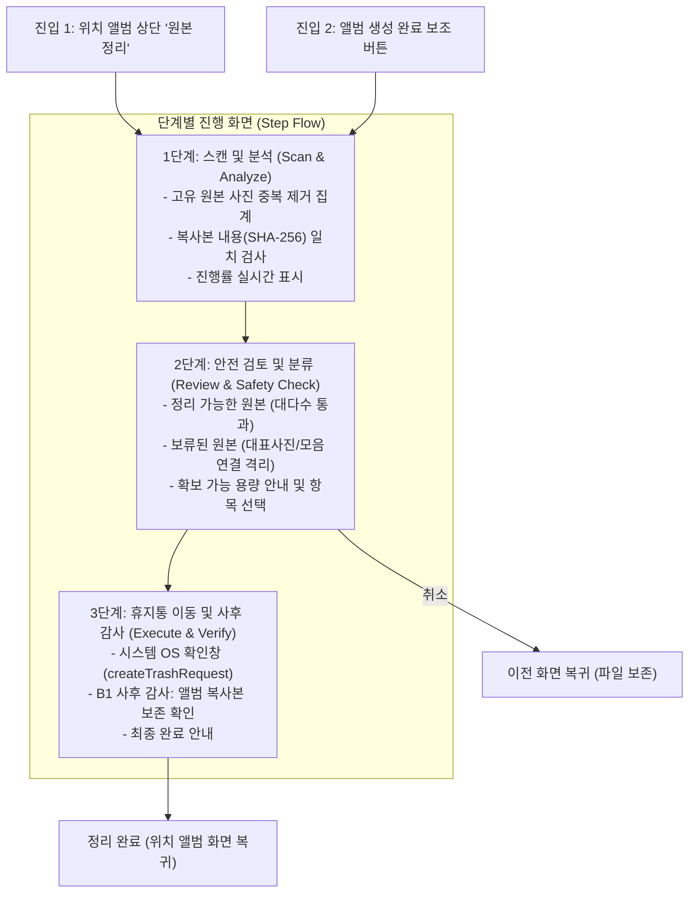

# PhotoPlace — 원본 사진 정리 단계별 진행 화면 및 개별 연결 격리 설계안 (DESIGN)

> **문서 상태**: 검토용 초안 (Draft for Codex & Antigravity Collaborative Review)  
> **작성일자**: 2026-10-25  
> **핵심 원칙**: 
> 1. 사진 중복 집계 제거 (고유 원본 사진 단위의 일관된 카운트)
> 2. 전체 보류(Set-wide) 탈락을 없애고 개별 사진 단위(Item-level) 연결 검사 및 보류 격리
> 3. 팝업을 전면 폐기하고 직관적인 단계별 진행 화면(Step-by-Step Flow Screen) 도입
> 4. 위치 앨범 상단 '원본 정리' + 앨범 생성 완료 화면 보조 버튼 진입 동선 정립
> 5. [P0] `MainActivity.java` 0줄 비즈니스 로직 격리 및 [P1] Read-only / OS 휴지통 승인 엄수

---

## 1. 배경 및 문제 분석 (Background & Problems)

### 1.1 현상 및 사용자 피드백
- **사용자 제보 요약**:
  - `3,513쌍`: 이번 검색에서 찾은 원본 ↔ 앨범 복사본 후보.
  - `3,778쌍`: 기존 기록 265건까지 포함한 검사 수 (동일 사진 중복 집계 가능성).
  - `통과 0쌍`: 내용은 일치했으나 기록 연결 검사에서 전체가 일괄 보류됨.
  - "모음·대표사진 연결 확인 필요 3,778쌍" 표시는 각 사진마다 문제가 있다는 뜻이 아니며, 전체 보류 사유를 개별 문제처럼 표시하여 큰 오해를 유발함.

### 1.2 근본 원인 분석
1. **숫자 기준 혼선 & '쌍(Pair)' 단위 집계 오류**:
   - 원본 사진 1장이 여러 위치 앨범에 복사된 경우 또는 스캔 결과와 기존 DB 기록이 합쳐지는 과정에서 '쌍(Pair)' 단위로 카운트되어 숫자가 부풀려지고 실제 정리할 원본 사진(고유 사진) 수가 가려짐.
2. **`MemoryDependencyGuard`의 Set-wide 단일 실패 파급**:
   - `MemoryDependencyGuard.check(records, before, after)`가 3,778개 쌍 전체를 한꺼번에 검사함.
   - 단 1장의 사진이라도 `directUriReferences` (모음 대표사진, 메모 커버 등)에 닿아 있으면 가드가 즉시 `COLLECTION_DEPENDENCY`를 반환.
   - `CleanupReviewCoordinator`가 이 단일 상태를 3,778개 후보 전원에게 `candidate.dependencyStatus = wholeSelectionStatus`로 일괄 할당함.
   - 그 결과 아무런 연결도 없는 99%의 깨끗한 사진들까지 "모음·대표사진 연결 확인 필요"로 오표기되며 전량 탈락함.
3. **팝업 다이얼로그의 한계**:
   - 수천 장의 사진 무결성 검증, 보류 사유 설명, 선택/해제, 안전 검토를 작은 팝업창(`AlertDialog`) 안에서 텍스트로만 욱여넣어 사용자가 안심하고 사용할 수 없음.

---

## 2. 사용자 경험 및 진입 동선 (UX Flow)

### 2.1 진입 경로 (Entry Points)
1. **[진입 경로 1: 주요 상시 경로] 위치 앨범 상단 ‘원본 정리’ 버튼**
   - 위치 앨범 탭(`addRecentPlacesHeader`) 우측에 명확한 '원본 정리' 아이콘/텍스트 버튼 배치.
   - 사용자가 위치 앨범들을 둘러보며 언제든지 "복사된 원본을 정리할 때가 되었다"고 판단하면 바로 실행 가능.
2. **[진입 경로 2: 상황별 보조 경로] 앨범 생성 완료 후 보조 버튼**
   - 사진 정리를 마치고 위치 앨범이 새로 생성된 직후의 완료 화면(`MemoryOrganizationCompletionRenderer`).
   - 주 버튼("위치 앨범 보기") 하단에 "복사된 원본 사진 정리" 보조 버튼(Secondary Button) 제공.

### 2.2 화면 전이 흐름 (Flow Lifecycle)



---

## 3. 화면 UI 구조 (Wireframe)

### 3.1 [Step 1] 분석 진행 상태 (화면 내 프로그레스 카드)
```text
+-------------------------------------------------------------+
| ← 원본 사진 정리                                            |
+-------------------------------------------------------------+
|                                                             |
|   위치 앨범에 복사된 원본 사진을 확인하고 있어요            |
|   복사본과 내용이 100% 같은지 안전하게 검증합니다           |
|                                                             |
|   [========================>              ]  64%            |
|   원본 사진 3,513장 중 2,248장 검사 완료...                 |
|                                                             |
|   • 고유 원본 사진: 3,513장                                 |
|   • 확인된 위치 앨범: 28개 앨범                             |
|                                                             |
|   [ 멈추기 ]                                                |
+-------------------------------------------------------------+
```

### 3.2 [Step 2] 검토 및 분류 화면 (메인 리뷰 화면)
```text
+-------------------------------------------------------------+
| ← 원본 사진 검토                                            |
+-------------------------------------------------------------+
| [요약 카드]                                                 |
|  정리 가능한 원본 사진 3,510장 (12.4 GB)                    |
|  • 위치 앨범에 안전하게 복사되어 원본만 휴지통으로 이동 가능 |
|  • 기억 모음/대표사진 연결 사진 3장은 안전하게 보호(보류)됨 |
+-------------------------------------------------------------+
| [탭: 정리 가능 (3,510)]     [탭: 보류된 사진 (3)]           |
+-------------------------------------------------------------+
| [v] 전체 선택 (3,510장 모두 선택)                           |
| ----------------------------------------------------------- |
| [v] [썸네일] 20260430_142927.jpg                     4.2 MB |
|     복사된 위치: Pictures/용인에서/                         |
| ----------------------------------------------------------- |
| [v] [썸네일] 20191113_184832.jpg                     3.8 MB |
|     복사된 위치: Pictures/수원에서/                         |
| ----------------------------------------------------------- |
|                                                             |
| (보류 탭 선택 시)                                           |
| [!] [썸네일] IMG_20240217.jpg                        5.1 MB |
|     보류 사유: '제주 여행' 기억 모음의 대표 커버 사진      |
|     안내: 대표사진으로 지정되어 있어 정리 대상에서 제외됨   |
+-------------------------------------------------------------+
| [ 선택한 원본 3,510장 휴지통으로 이동 (12.4 GB) ] (보라색)  |
+-------------------------------------------------------------+
```

### 3.3 [Step 3] 완료 및 사후 감사 결과
```text
+-------------------------------------------------------------+
| 원본 사진 정리 완료                                         |
+-------------------------------------------------------------+
|                                                             |
|   (체크 아이콘)                                             |
|   사진 3,510장의 원본이 휴지통으로 이동되었습니다           |
|   위치 앨범의 복사본은 안전하게 보존되었습니다              |
|                                                             |
|   • 확보된 저장 공간: 약 12.4 GB                            |
|   • 보존된 모음/대표 사진: 3장                              |
|   • 실수로 지운 사진은 30일 내 갤러리 휴지통에서 복구 가능  |
|                                                             |
|   [ 확인 ]                                                  |
+-------------------------------------------------------------+
```

---

## 4. 핵심 기술 사양 (Technical Specifications)

### 4.1 고유 원본 사진 단위의 중복 제거 (Unique Source Deduplication)
- **식별 기준**: `sourceUri`
- **구조체**: `CleanupUniqueSourceItem`
  ```java
  final class CleanupUniqueSourceItem {
      final String sourceUri;
      final String displayName;
      final long size;
      final long dateTaken;
      final List<String> targetUris;
      final List<String> targetAlbumPaths;
      CleanupPairVerifier.Status contentStatus;
      ItemDependencyStatus dependencyStatus;
      String heldReason; // null if eligible
  }
  ```
- 기존 DB 기록과 스캔 결과를 `sourceUri` 키로 머지하여, 동일한 사진이 중복 카운트되는 현상을 원천 차단.
- 유저에게 보여주는 숫자는 오직 **"고유 원본 사진 X장"**.

### 4.2 개별 사진 단위 연결 검사 및 보류 격리 (Item-level Dependency Guard)
- 전체 세트 실패(Set-wide Failure) 방식을 **개별 사진 단위 평가(Item-level Evaluation)** 로 전환:
  1. **직접 참조 검사 (`directUriReferences`)**:
     - `sourceUri`가 모음 커버, 개인화 메모 커버 등에 직접 사용되었는가?
     - 참이면 -> `HELD_COVER_REFERENCE` ("모음 또는 메모 대표사진으로 사용 중")
  2. **메모리 그룹 대체 검사 (`sourceMemories`)**:
     - `sourceUri`가 특정 기억 그룹에 속해 있는가?
     - 속해 있다면, 대상 위치 앨범에 해당 날짜 사진이 대체되어 존재하는가?
     - 안전하게 대체되면 -> `PRESERVED` (정리 가능)
     - 대체 불가능하여 날짜 섹션이 유실되면 -> `HELD_DATE_SECTION_LOSS` ("날짜별 모음 연결 유지 필요")
  3. **일반 원본 사진 (`Download/`, `Camera/` 등)**:
     - 메모리 그룹에 속하지 않는 순수 사진 -> 즉시 `PRESERVED` (정리 가능)
- **결과 분리**:
  - `List<CleanupUniqueSourceItem> eligibleItems` (정리 가능)
  - `List<CleanupUniqueSourceItem> heldItems` (보류됨 및 개별 사유 포함)
  - 전체가 0장으로 블로킹되는 결함을 완벽히 해소.

### 4.3 0줄 격리 원칙 [P0] 및 컴포넌트 분리
`MainActivity.java`는 단지 화면 전환 신호만 받고, 실제 모든 UI 구성과 비즈니스 로직은 전용 클래스로 위임:
- `CleanupStepFlowPresenter`: 단계별 상태(SCANNING, REVIEW, TRASHING, AUDITING, COMPLETE) 관리.
- `CleanupStepFlowRenderer`: 단계별 화면 뷰 생성, 탭 전환, 썸네일 바인딩, 체크박스 이벤트 처리.
- `CleanupCandidateResolver`: 중복 제거 및 개별 의존성 격리 계산기 (단위 테스트 100% 커버).

---

## 5. Codex 협업 작업 분담 계획 (Work Breakdown)

| 단계 | 작업 내용 | 담당 | 산출물 |
|---|---|---|---|
| **Phase 1: 도메인 격리** | 고유 원본 중복 제거 모델 (`CleanupUniqueSourceItem`) 및 개별 연결 격리 가드 (`ItemDependencyGuard`) 구현 및 단위 테스트 작성 | Antigravity & Codex | `CleanupCandidateResolver.java`, `CleanupCandidateResolverTest.java` |
| **Phase 2: UI 렌더러 분리** | 팝업 제거, 단계별 진행 화면 뷰 렌더러 (`CleanupStepFlowRenderer`, `CleanupStepFlowPresenter`) 구현 | Codex | `CleanupStepFlowRenderer.java`, `CleanupStepFlowPresenter.java` |
| **Phase 3: 진입점 연결** | 1) 위치 앨범 상단 '원본 정리' 헤더 버튼 연결<br>2) 앨범 생성 완료 화면 보조 버튼 연결 | Codex & Antigravity | `addRecentPlacesHeader` 연동, `MemoryOrganizationCompletionRenderer.java` |
| **Phase 4: 검증 및 빌드** | 단위 테스트 실행, Play 공식 서명 빌드(versionCode 45), 실기기(Galaxy Fold) 3,715장 검증 | Antigravity | `photoplace-1.3.12-code45-play-signed.apk`, 리뷰 리포트 |
