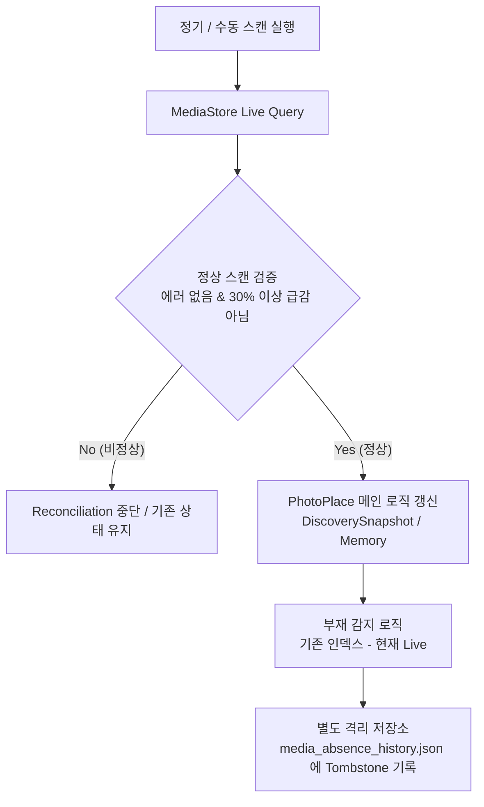

# PhotoPlace - 로컬 미디어 부재 이력 추적 설계 리뷰 (Local Media Absence Tracking)

> **문서 상태**: 설계 검토 완료 (구현 보류 / 최소 대비 가이드)  
> **관련 프로젝트**: PhotoPlace (GallerySorter) & 향후 정리 프로젝트 ("잊어버린 쓰레기")  
> **작성일자**: 2026-08-29

---

## 1. 개요 및 배경

### 1.1 배경
PhotoPlace와는 별도로 "과거 로컬에 있었으나 후속 스캔에서 사라진 사진"을 향후 클라우드/보관 사진 정리 후보 신호로 활용하는 정리 프로젝트("잊어버린 쓰레기")를 구상 중이다.

### 1.2 목표
PhotoPlace가 과거에 실제로 확인한 로컬 미디어가 이후 스캔에서 발견되지 않을 때, 향후 외부 프로젝트에서 안전하게 활용할 수 있도록 **최소한의 메타데이터 이력(Tombstone/Absence History)**만 남기는 방안을 검토한다.

### 1.3 제약 조건
- PhotoPlace의 기존 기능 흐름(위치 분석, 기억 브라우징, 앨범 생성)을 방해하지 않을 것
- 원본 이미지나 썸네일 바이너리를 앱 내부 스토리지에 별도 보관하지 않을 것
- 무거운 AI, 이미지 디코딩(Perceptual Hash), 바이너리 SHA 연산 배제
- Google Photos 연동 및 삭제 자동화 기능 배제
- 매번 강제 전체 스캔을 요구하지 않을 것
- 과설계(Over-engineering) 방지

---

## 2. 10대 핵심 질문 검토 결과

### Q1. PhotoPlace에 이런 이력을 지금 넣어두는 게 구조적으로 합리적인가?
- **조건부 합리적**: PhotoPlace 자체 기능에는 필요 없으나, **"로컬에서 사진이 사라진 이후에는 파일 크기, 해상도, 정밀 촬영시각 등의 메타데이터를 영구히 복원할 수 없다"**는 점에서 최소한의 사전 메타데이터 수집 가치는 충분함.
- 다만 복잡한 상태 머신 대신 **비간섭형 부재 기록 덤프(Absence History Dump)** 수준으로 제한해야 함.

### Q2. 최소한 어떤 데이터만 남기면 충분한가?
- **식별/매칭용**: `displayName` (파일명), `takenAtMillis` (정밀 촬영시각), `sizeBytes` (파일 크기), `width` / `height` (해상도)
- **관측 시점**: `firstSeenAtMillis`, `lastSeenAtMillis`, `missingDetectedAtMillis`
- **PhotoPlace 맥락**: `locationKey` / `placeName` (PhotoPlace가 기 파싱한 위치 정보)

### Q3. 기존 Media Entity 필드 추가 vs 별도 History 테이블/파일?
- **별도 격리 저장소(`media_absence_history.json`) 분리가 최적.**
- PhotoPlace는 JSON 기반 스냅샷 구조를 사용하므로, 활성 미디어 스냅샷(`DiscoverySnapshot`)에 사라진 항목을 계속 누적하면 I/O 및 파싱 비용이 누적됨. 완전 분리 시 PhotoPlace 메인 기능에 영향 0%.

### Q4. firstSeenAt / lastSeenAt / missingDetectedAt 필요성
- **매우 유용**: 
  - `lastSeenAt`과 `missingDetectedAt` 사이의 구간을 통해 "사용자가 특정 시점에 일괄 공간 확보(Free up space)를 했는지" vs "촬영 며칠 만에 수동 삭제했는지(단순 쓰레기 사진)"를 판별하는 핵심 신호가 됨.

### Q5. 식별자별 실질적 의미 및 가치 평가
| 항목 | 가치 | 평가 이유 |
| :--- | :---: | :--- |
| **MediaStore ID** | ❌ 무의미 | 삭제 시 무효화되며 OS 업데이트/기기변경/재색인 시 재할당됨 |
| **Content URI** | ❌ 무의미 | 미디어 부재 시 resolve 불가 |
| **파일명 (`displayName`)** | ⭐ 필수 | 클라우드/백업 매칭의 기본 키 |
| **촬영시각 (`takenAt`)** | ⭐ 필수 | EXIF/MediaStore 정밀 시각 (클라우드 매칭 제2 키) |
| **파일 크기 (`sizeBytes`)** | ⭐ 필수 | 초경량 동일 파일 검증 지표 |
| **해상도 (`width` / `height`)** | ⭐ 필수 | 파일명이 변경된 클라우드 사진 매칭의 결정적 키 |

### Q6 & Q7. Lightweight Fingerprint 가치 및 실현 가능성
- **결론: 픽셀/바이너리 해시(SHA-256, pHash)는 불필요하며, `Metadata Composite Key`가 최적.**
- **이유**:
  - Google Photos API나 Takeout은 바이너리 SHA 해시를 대조용으로 제공하지 않으며, Storage Saver 압축 시 바이너리가 변형됨.
  - 픽셀 디코딩 및 전체 파일 Read는 I/O, 배터리 소모를 유발함.
- **최적의 키**:
  `Composite Key = takenAtMillis + "_" + sizeBytes + "_" + width + "x" + height + "_" + displayName`

### Q8. 대량 False Positive(오탐) 방지 안전장치
1. **Query Exception / Empty Safety**: Cursor 예외 발생 시 reconciliation 즉시 중단.
2. **Blast Radius (Circuit Breaker)**: 단일 스캔에서 관리 대상의 30% 이상(또는 200개 이상) 급감 시 기록 유예(동결).
3. **Multi-Scan Confirmation (2회 연속 미발견)**: 1회 미발견은 후보(`UNCONFIRMED_MISSING`), 별도 시점의 다음 스캔에서도 미발견 시 최종 `ABSENT` 확정.

### Q9. DB 용량 및 스캔 성능 영향
- **성능 영향**: MediaStore 커서 프로젝션에 `SIZE`, `WIDTH`, `HEIGHT` 추가는 인덱스 컬럼이므로 조회 오버헤드 **0ms**. In-memory Set Diff는 10,000장 기준 **5ms 미만**.
- **저장 용량**: JSON 레코드 1건당 약 150~180 Bytes. 부재 미디어 2,000건 누적 시 약 **300KB** 수준으로 극히 미미.

### Q10. 작업 범위 분리 (Now vs Later)
- **Now (PhotoPlace)**:
  1. 스캔 시 `size`, `width`, `height` 메타데이터 필드 보강.
  2. 스캔 종료 후 메인 흐름과 격리된 부재 미디어 덤프(`media_absence_history.json`) 작성 (옵션).
- **Later (정리 프로젝트 "잊어버린 쓰레기")**:
  1. Google Photos API/Takeout 매칭 알고리즘.
  2. 부재 원인 추정(공간확보 vs 수동삭제 vs 연사).
  3. 정리 추천 점수화 및 삭제 자동화.

---

## 3. 권장 아키텍처 및 데이터 흐름



### 3.1 부재 엔티티 스키마 (`MissingMediaEntry`)

```json
{
  "schemaVersion": 1,
  "updatedAtMillis": 1725000000000,
  "entries": {
    "1719820391000_3491022_4032x3024_IMG_20260630.jpg": {
      "displayName": "IMG_20260630.jpg",
      "takenAtMillis": 1719820391000,
      "sizeBytes": 3491022,
      "width": 4032,
      "height": 3024,
      "mimeType": "image/jpeg",
      "locationKey": "KR_SEOUL_GANGNAM",
      "placeName": "강남구",
      "firstSeenAtMillis": 1719825000000,
      "lastSeenAtMillis": 1722410000000,
      "missingDetectedAtMillis": 1725000000000,
      "consecutiveMissingScans": 2
    }
  }
}
```

---

## 4. 위험 요소 및 대응 원칙

1. **'삭제(Deleted)' 용어 사용 금지**:
   - 로컬 미디어의 부재는 Google Photos 공간 확보, 파일 이동, 권한 변경 등 다양한 사유가 있으므로 시스템 내 용어는 반드시 **`LOCAL_ABSENT` (로컬 부재)**로 통일한다.
2. **MediaStore `_ID` 신뢰 금지**:
   - 기기 변경, 팩토리 리셋, OS 업데이트 시 ID가 변경되므로 **메타데이터 복합 키**를 유일 식별자로 취급한다.
3. **PhotoPlace 핵심 가치 훼손 금지**:
   - 이 기능을 위한 UI 노출, 재스캔 유도, 알림 등은 PhotoPlace에 절대 추가하지 않는다.

---

## 5. 최종 추천 및 로드맵

> **결론: "조건부 최소 구현 (Phase 1만 적용)" 권장**

- **즉시 적용 권장 (Phase 1)**:
  - 현재 PhotoPlace의 스캔 쿼리에 `SIZE`, `WIDTH`, `HEIGHT` 메타데이터가 누락되지 않도록 수집 필드 보강.
  - 메인 UI/비즈니스 로직과 완전 격리된 `MediaAbsenceHistoryStore` (약 50라인)를 두어 스캔 시 백그라운드 덤프만 수행.
- **보류 (Future Project)**:
  - 복잡한 다단계 상태 머신 UI, 클라우드 연동, 정리 추천 로직은 일체 구현하지 않고 별도 정리 프로젝트로 이관.
