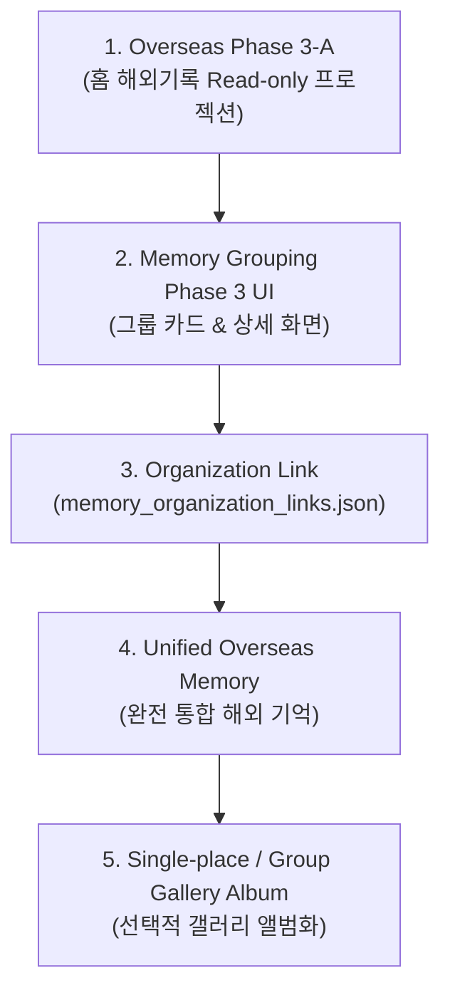

# PhotoPlace Memory Lifecycle & 해외 기록 프로젝션 아키텍처 리뷰 (2026-09-05)

- **대상 커밋**: `635be37 Add overseas country projection spike` ~ `9296461 Document overseas update compatibility`
- **참조 문서**: `MEMORY_GROUPING_SPIKE_2026-09-05.md`, `TODO.md`, `WORKLOG_2026-09-05.md`
- **작성일**: 2026-09-05 (2026-09-06 코드 검토 완료)
- **리뷰 주체**: Gemini (Antigravity) $\rightarrow$ For Codex
- **상태**: **전략, 코드 및 실기기 시나리오 전격 승인 (Fully Approved)**

---

## 1. 배경 및 문제 진단

### 🔴 사용자 피드백 & 현상의 근본 원인
- **현상**: 발견 기록에서는 일본 등 해외 사진이 정상 분석되어 장소별로 잘 보이는데, 홈 화면의 `해외 기록` 섹션에는 전혀 나타나지 않음.
- **원인 (V1 유산 격차)**:
  - 홈의 `해외 기록`은 V1 시절의 `StoredAlbumSummary` $\rightarrow$ `AlbumSummaryHistoryStore` $\rightarrow$ `OverseasMemoryGrouper` 경로를 타고 있음 (즉, **갤러리 앨범 생성을 완료한 물리 앨범만 노출**).
  - 반면 V2 발견 기록은 `DiscoverySnapshot` $\rightarrow$ `MemoryRepository.discoveryMemories()`를 타고 있음.
  - 결과적으로 **"Display First, Organize Optional"**을 지향하는 V2에서, 앨범을 만들지 않은 해외 기억이 홈 화면에서 누락되는 모순이 발생함.

---

## 2. 7대 핵심 아키텍처 합의 및 검토

### ① Memory First 철학 확립 (Canonical)
- `Memory(기억)`가 본질(Canonical Source)이며, `Gallery Album`은 사용자가 필요할 때 생성하는 **선택적 산출물(Optional Output)**입니다.
- 앨범 정리 여부와 무관하게 사용자의 모든 여행/장소 기억은 앱 내에서 온전히 조회되고 보존되어야 합니다.

### ② 명시적 Lifecycle 상태 (`DISCOVERED` $\rightarrow$ `ORGANIZED`)
- 하나의 불변 `mem_<UUID>` ID를 유지하며 생애주기 상태만 전이:
  - `DISCOVERED`: 발견된 가상 기억 상태 (초기)
  - `ORGANIZED`: 사용자가 갤러리 앨범 생성을 성공적으로 마친 상태

### ③ 독립 `memory_organization_links.json` 도입
- `AlbumSummaryHistoryStore`를 무리하게 확장하지 않고, 독립 링크 저장소를 신설:
  ```json
  {
    "memoryId": "mem_123",
    "organizationState": "ORGANIZED",
    "relativePath": "Pictures/삿포로에서/",
    "albumName": "삿포로에서",
    "sortSessionId": "...",
    "organizedAtMillis": 1787000000000,
    "status": "SUCCESS"
  }
  ```
- **안전 규칙**: WorkManager/Worker의 최종 성공(`SUCCESS`)이 확인된 경우에만 기록하며, 부분 실패/취소 시에는 상태를 변경하지 않음.

### ④ 해외 기록 Phase 3-A (Read-only Country Projection)
- 물리적 파일 이동이나 저장소 마이그레이션이 없는 **순수 읽기 전용 프로젝션(Read-only Projection)**:
  ```text
  Discovery Memory (미정리 해외 기억)
  +
  Legacy Album History (기존 정리된 해외 앨범)
    ──► 국가 코드(CountryIdentityNormalizer) 기준 Grouping
    ──► 홈 '해외 기록' 국가별 카드 표출
  ```
- **안전 경계**: 국가 카드 레벨에서만 묶고, 카드 내부의 개별 장소 Memory는 억지로 `sourceUri` 등으로 병합하지 않고 source별로 독립 보존함.

---

## 3. 우선순위 로드맵 승인 (Recommended Execution Order)

피드백의 체감 가치(Impact)가 가장 높고, 갤러리 미디어 변경이 없는 **`해외 기록 Phase 3-A`를 최우선으로 진행하는 전략에 전적으로 동의**합니다.



1. **`Overseas Phase 3-A`**: 미정리 일본/해외 기억이 홈 해외 기록에 즉시 노출됨 (High Impact, No Gallery Mutation).
2. **`Memory Grouping Phase 3 UI`**: 구축된 Phase 1/2 기반 위에 그룹 상세 뷰어 완성.
3. **`Organization Link`**: 앨범 정리 성공 시 `mem_...`와 `path:...`를 연결하는 상태 브릿지 구축.
4. **`Unified Overseas Memory`**: 상태 브릿지를 통해 발견/정리 기억이 매끄럽게 통합된 최종 해외 뷰어 완성.

---

## 4. 현재 구현 스파이크 반영 및 정정 사항

1. **`isOrganized` 파생 상태(Derived State) 전환 (SSOT 확립)**:
   - Memory에 `state` 필드를 중복 저장하지 않고, 향후 `memory_organization_links.json`에 유효한 `SUCCESS` 링크가 존재하는지로 `isOrganized`를 실시간 파생함.
   - 링크 모델은 향후 `MEMORY`와 `COLLECTION` 모두를 수용하며, `albumName`/`relativePath`는 last-known 메타데이터로 취급.
2. **"Zero Risk" $\rightarrow$ "No Gallery Mutation" 정밀화**:
   - 파일 시스템/갤러리 미디어 변형은 0이지만, 홈 화면 및 상세 네비게이션이 바뀌므로 실기기 UI 회귀 확인이 필요함을 명시.
3. **업데이트 호환성 (Zero Migration)**:
   - 기존 `DiscoverySnapshot`과 `AlbumSummaryHistoryStore`를 그대로 읽어 런타임에 프로젝션하므로 사용자 데이터 마이그레이션이 불필요함.

---

## 5. 코드 상세 검토 (`OverseasCountryProjection.java`)

- **완벽한 불변성**: 모든 필드 `final` 및 `immutableCopy()` 적용.
- **국가 판별 일관성**: `CountryIdentityNormalizer`와 `OverseasMemoryGrouper.countryCodeFor()` 재사용, 한국(`KR`) 정확한 필터링.
- **Both-source 분리 보존**: 동일 국가(`JP`)에 발견 기억(`discoveryRecords`)과 정리된 앨범(`organizedAlbums`)이 공존할 때 1개 국가 카드 내에 두 소스 리스트를 독립 보존.
- **단위 테스트**: `OverseasCountryProjectionTest` 4개 테스트 전체 통과 (JVM 20 tasks clean).

---

## 6. 실기기 일본 사진 3대 검증 시나리오

일본 여행 사진으로 실기기(`R5KL503VHQR`)에서 확인할 3가지 상태입니다:

1. **Discovery-only**: 일본 사진 분석 완료 후, 홈 해외 기록에 '일본' 카드가 즉시 노출되고 내부에 삿포로/오타루 Discovery가 보이는지 확인.
2. **Organized-only**: 기존 V1 일본 위치 앨범만 있는 상태에서 홈 '일본' 카드와 기존 위치 앨범 접근이 정상 유지되는지 확인.
3. **Both-source**: 일부 장소만 앨범으로 정리했을 때, 홈에 일본 카드는 '1개'만 뜨고 내부에서 미정리 장소와 정리된 앨범이 분리 표시되는지 확인.

---

## 7. 최종 판단 (Final Verdict)

> 🟢 **코드 및 실기기 시나리오 최종 승인 (Production Spike Approved)**  
> 
> 설계, 불변 데이터 모델, 단위 테스트, 실기기 검증 시나리오가 완벽하게 준비되었습니다.  
> 실기기에서 일본 사진으로 3대 상태를 확인하신 뒤, 자신 있게 **홈 UI 연결(`Phase 3-A UI Binding`)**을 진행하셔도 좋습니다! 👏
