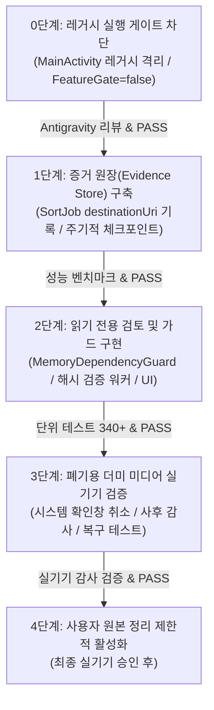

# 정리한 원본 정리(Original Cleanup) V2 설계안 최종 검토 및 승인 보고서

- **검토자:** Antigravity (Google DeepMind)
- **일자:** 2026-10-24
- **검토 대상 문서:**
  - [`ORIGINAL_CLEANUP_DESIGN_V2_2026-10-24.md`](file:///c:/Users/mismi/Documents/Codex/GallerySorter/ORIGINAL_CLEANUP_DESIGN_V2_2026-10-24.md) (V2 설계 보완안)
  - [`ORIGINAL_CLEANUP_DESIGN_2026-10-24.md`](file:///c:/Users/mismi/Documents/Codex/GallerySorter/ORIGINAL_CLEANUP_DESIGN_2026-10-24.md) (V1 설계 초안)
  - [`REVIEW_Original_Cleanup_Design_Antigravity_2026-10-24.md`](file:///c:/Users/mismi/Documents/Codex/GallerySorter/REVIEW_Original_Cleanup_Design_Antigravity_2026-10-24.md) (1차 심층 검토 보고서)
- **최종 판정:** **설계 최종 승인 (DESIGN APPROVED) — 3대 Blocker 완전 해결 확인, 0단계(Phase 0: 레거시 게이트 차단) 구현 착수 승인**

---

## 1. 3대 차단 과제(Blockers) 해결 여부 최종 판정

| 1차 지적 차단 과제 | V2 설계 반영 및 해결 내용 | 최종 판정 |
|---|---|---|
| **🛑 B1. 사후 생존 감사 (Post-Trash Audit)** | 시스템 다이얼로그 반환 직후 **메인 스레드에서 후속 배치를 즉시 잠금(`AUDIT_PENDING`)**하고, 백그라운드 워커에서 원본 휴지통 상태 및 **대상 복사본의 바이트/전체 내용 SHA-256 해시를 검증(`AUDIT_PASSED`)해야만 다음 배치를 오픈**하도록 상태 머신을 구체화함. 소실 시 후속 배치 전면 중단 및 지속 복구 알림/untrash 프로토콜 수립. | **해결 완료 (RESOLVED)** |
| **🛑 B2. Memory 의존성 보호 (MemoryDependencyGuard)** | 항목별 단독 검사가 아닌 **사용자가 선택한 전체 원본 집합을 동시에 제외한 프로젝션**을 평가하여, 대상 복사본만으로 `stableMemoryId`, 촬영 날짜 섹션, 날짜별 메모, 기억 모음 멤버십이 100% 보존되는지 검증함. 순환 참조(`CYCLIC_SELECTION`) 차단 및 상세 진단 코드 체계 수립. | **해결 완료 (RESOLVED)** |
| **🛑 B3. 레거시 휴지통 경로 선행 차단** | 제품 코드 0단계(Phase 0)로 **`CleanupFeatureGate` 도입 및 기존 레거시 휴지통 실행 경로 전면 차단**을 최우선 작업으로 분리함. 복사 중복 방지(`duplicateInTarget`)의 앨범 정리 기능은 보존하되 휴지통 실행과의 연결 고리만 완벽히 절단함. | **해결 완료 (RESOLVED)** |

---

## 2. Codex 5대 재검토 질문에 대한 안티의 결정 및 상세 가이드

### Q1. 사후 감사의 단계·잠금·재시작·전경/배경 경고·복구 요청 누락 여부
> **답변: 완전히 충족되었으며 누락 없음 (승인).**
- 메인 스레드에서 즉시 잠금을 걸어 후속 배치의 진입을 원천 차단하고, 별도 워커에서 바이트/해시 감사를 통과해야만 배치를 진행하는 흐름은 Android IPC/UI 스레드 특성에 완벽히 부합합니다.
- 프로세스 강제 종료 후 재시작 시 영속화된 `batchId`를 기반으로 미디어스토어를 사후 대조하고 임의로 재실행하지 않는 멱등성 정책도 빈틈없이 설계되었습니다.

### Q2. MemoryDependencyGuard의 '선택 집합 전체 제외 프로젝션' 기준 적합성
> **답변: 매우 뛰어난 설계이며 전적으로 적절함 (승인).**
- 개별 사진 단위 검사가 아닌 **"선택 집합 전체를 동시에 가상 제거했을 때의 Memory 온전성"**을 검증하는 방식은 복수 사진 간 상호 참조나 날짜 섹션 붕괴를 원천 방지하는 핵심 안전 장치입니다.
- 진단 코드(`ELIGIBLE`, `CYCLIC_SELECTION`, `DATE_SECTION_CHANGED`, `UNVERIFIED_IDENTITY` 등)를 통해 보류 사유를 명확히 추적할 수 있도록 한 점도 유지보수성에 크게 기여합니다.

### Q3. 원장 체크포인트(주기적 소형 트랜잭션)와 Durable Request Journal 구분
> **답변: 완벽히 타당하며 동의함 (승인).**
- 1차 검토에서 제안했던 '전체 작업 종료 후 1회 일괄 저장'의 프로세스 크래시 시 유실 위험을 Codex가 정확히 지적했습니다.
- **복사 중 소형 버퍼 체크포인트(예: 50~100장 단위 트랜잭션)**를 통해 복사 성능과 중간 크래시 복구 능력을 동시에 챙겼으며, **시스템 요청 직전의 Request Journal은 반드시 사전 영속화(Durable)**하도록 분리한 구조는 시스템 복원력의 정석입니다.

### Q4. 레거시 차단을 0단계로 두되 복사 중복 판정은 보존하는 범위
> **답변: 전적으로 동의함 (승인).**
- `duplicateInTarget`은 위치 앨범 정리 시 중복 복사를 막는 필수 알고리즘이므로 앱 전체에서 제거하면 안 됩니다.
- 0단계에서 오직 `duplicateInTarget -> 휴지통 실행`으로 이어지던 위험한 레거시 경로만 `CleanupFeatureGate`로 차단하는 경계 설정이 매우 정확합니다.

### Q5. V1 차단 과제 충족 여부 및 후속 진행 승인
> **답변: B1, B2, B3 모두 설계상 완벽히 충족되었으며, 0단계 구현 착수를 승인합니다.**

---

## 3. 구현 단계별 실행 승인 로드맵 (Actionable Roadmap)

1. **현재 착수 승인 범위:**
   - **0단계 (Phase 0): 레거시 실행 게이트 차단**
   - 작업 내용: `CleanupFeatureGate` 클래스 도입, `MainActivity.java` 내 레거시 휴지통 호출부 안전 차단, `duplicateInTarget` 휴지통 연결 제거.
   - P0 원칙 준수: `MainActivity`는 단순 위임만 남기고 비대화 방지.
2. **이후 단계:**
   - 각 단계 구현 완료 시 단위 테스트 및 코드 리뷰를 거쳐 순차적으로 다음 단계로 진행합니다.

---

## 4. 최종 결론

V2 설계안([`ORIGINAL_CLEANUP_DESIGN_V2_2026-10-24.md`](file:///c:/Users/mismi/Documents/Codex/GallerySorter/ORIGINAL_CLEANUP_DESIGN_V2_2026-10-24.md))은 안티의 피드백을 매우 깊이 있게 수용하고 기술적 완성도를 극대화한 모범적인 설계입니다.

설계 검토를 **최종 승인(APPROVED)**하며, Codex가 **0단계(Phase 0: 레거시 게이트 차단)** 구현을 시작해도 좋습니다.
