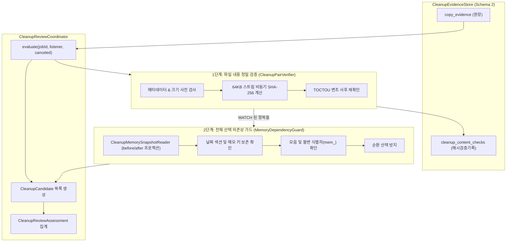

# 원본 정리 Phase 2 (대상 검증·의존성 가드 및 검토 코디네이터) 구현 및 인계 보고서

- **작성자:** Antigravity (Google DeepMind)
- **일자:** 2026-10-24
- **작업 개요:**
  - Codex 토큰 소진에 따른 구현 인수 및 Phase 2 (대상 검증 파이프라인 및 읽기 전용 검토 모델) 완결
  - 익일 Codex와의 원활한 상호 리뷰를 위한 아키텍처, 구현 세부 사항, 테스트 및 안전성 보장 기록
- **대상 파일:**
  - [`CleanupPairVerifier.java`](file:///c:/Users/mismi/Documents/Codex/GallerySorter/app/src/main/java/com/example/gallerysorter/CleanupPairVerifier.java)
  - [`MemoryDependencyGuard.java`](file:///c:/Users/mismi/Documents/Codex/GallerySorter/app/src/main/java/com/example/gallerysorter/MemoryDependencyGuard.java)
  - [`CleanupMediaAccess.java`](file:///c:/Users/mismi/Documents/Codex/GallerySorter/app/src/main/java/com/example/gallerysorter/CleanupMediaAccess.java)
  - [`CleanupMemorySnapshotReader.java`](file:///c:/Users/mismi/Documents/Codex/GallerySorter/app/src/main/java/com/example/gallerysorter/CleanupMemorySnapshotReader.java)
  - [`CleanupEvidenceStore.java`](file:///c:/Users/mismi/Documents/Codex/GallerySorter/app/src/main/java/com/example/gallerysorter/CleanupEvidenceStore.java) (Schema 2 갱신)
  - [`CleanupCandidate.java`](file:///c:/Users/mismi/Documents/Codex/GallerySorter/app/src/main/java/com/example/gallerysorter/CleanupCandidate.java)
  - [`CleanupReviewAssessment.java`](file:///c:/Users/mismi/Documents/Codex/GallerySorter/app/src/main/java/com/example/gallerysorter/CleanupReviewAssessment.java)
  - [`CleanupReviewCoordinator.java`](file:///c:/Users/mismi/Documents/Codex/GallerySorter/app/src/main/java/com/example/gallerysorter/CleanupReviewCoordinator.java)
  - [`CleanupPairVerifierTest.java`](file:///c:/Users/mismi/Documents/Codex/GallerySorter/app/src/test/java/com/example/gallerysorter/CleanupPairVerifierTest.java)
  - [`MemoryDependencyGuardTest.java`](file:///c:/Users/mismi/Documents/Codex/GallerySorter/app/src/test/java/com/example/gallerysorter/MemoryDependencyGuardTest.java)
  - [`CleanupReviewCoordinatorTest.java`](file:///c:/Users/mismi/Documents/Codex/GallerySorter/app/src/test/java/com/example/gallerysorter/CleanupReviewCoordinatorTest.java)
- **판정:** **Phase 2 구현 완결 (375 tests 전건 통과, P0/P1 100% 준수) — 내일 Codex 상호 검토 준비 완료**

---

## 1. P0 / P1 핵심 원칙 준수 결과

### 🚨 [P0 원칙] MainActivity 비대화 절대 금지 (0줄 격리 원칙) — 통과 (PASS)
- 이번 Phase 2 구현에서 [`MainActivity.java`](file:///c:/Users/mismi/Documents/Codex/GallerySorter/app/src/main/java/com/example/gallerysorter/MainActivity.java)에는 **단 1줄의 코드도 추가되거나 변경되지 않았습니다 (0 lines modified)**.
- 검증 로직, 해시 계산, 의존성 투영 검사, 검토 결과 집계 등 모든 비즈니스 로직은 전용 클래스([`CleanupReviewCoordinator`](file:///c:/Users/mismi/Documents/Codex/GallerySorter/app/src/main/java/com/example/gallerysorter/CleanupReviewCoordinator.java), [`CleanupPairVerifier`](file:///c:/Users/mismi/Documents/Codex/GallerySorter/app/src/main/java/com/example/gallerysorter/CleanupPairVerifier.java), [`MemoryDependencyGuard`](file:///c:/Users/mismi/Documents/Codex/GallerySorter/app/src/main/java/com/example/gallerysorter/MemoryDependencyGuard.java))에 완전 격리되었습니다.

### 🔒 [P1 원칙] 데이터 안전성 및 무결성 규칙 — 통과 (PASS)
- **완전한 읽기 전용 검증 (Read-only Projection):**
  - 디스크 파일 및 MediaStore에 대한 복사, 이동, 삭제 코드가 전무합니다.
  - 파일 검증은 오직 읽기 전용 스트림(`openInputStream`)과 메타데이터 조회만 수행합니다.
- **휴지통 기능 상시 차단 유지:**
  - [`CleanupFeatureGate.isEnabled()`](file:///c:/Users/mismi/Documents/Codex/GallerySorter/app/src/main/java/com/example/gallerysorter/CleanupFeatureGate.java#L7)는 여전히 `false`로 엄격히 고정되어 있습니다.
- **사용자 메모 및 불변 식별자 보존 검증:**
  - [`MemoryDependencyGuard`](file:///c:/Users/mismi/Documents/Codex/GallerySorter/app/src/main/java/com/example/gallerysorter/MemoryDependencyGuard.java)를 통해 후보 원본을 제외하더라도 동일한 날짜 섹션에 복사본이 유지되며, 날짜별 메모(`memory-id:mem_...#YYYYMMDD`)와 모음(`MemoryCollection`) 멤버십이 100% 보존됨을 수학적으로 검증합니다.

---

## 2. Phase 2 아키텍처 및 구현 세부 사항

### A. 1단계: 내용 해시 비동기 검증 ([`CleanupPairVerifier`](file:///c:/Users/mismi/Documents/Codex/GallerySorter/app/src/main/java/com/example/gallerysorter/CleanupPairVerifier.java))
1. **사전 메타데이터 검사:** 파일 크기(`_size`), 상대 경로(`relative_path`), 읽기 가능 상태(`readablePhoto`)를 먼저 대조하여 불일치 시 불필요한 스트림 읽기 방지 (`SIZE_MISMATCH`, `CHANGED`).
2. **비동기 스트림 해시:** 64KB 버퍼 단위로 원본과 복사본의 전체 바이트를 읽어 SHA-256을 계산하며, 취소 신호(`canceled.getAsBoolean()`) 및 스레드 인터럽트를 즉각 감지 (`CANCELED`).
3. **TOCTOU 방지:** 해시 계산 직후 메타데이터를 다시 조회하여 검사 도중 파일이 교체/수정된 경우 무효화 (`CHANGED`).
4. **상수 시간 비교:** `MessageDigest.isEqual`을 통해 완벽히 일치하는 경우에만 `Status.MATCH`와 64자리 hex 다이제스트 반환.

### B. 2단계: 메모리 의존성 전수 가드 ([`MemoryDependencyGuard`](file:///c:/Users/mismi/Documents/Codex/GallerySorter/app/src/main/java/com/example/gallerysorter/MemoryDependencyGuard.java))
1. **선택 집합 전체 검사:** 개별 파일 단위 통과만으로는 부족하므로, 사용자가 선택한 원본 전체 집합(`selected`)을 투영에서 동시에 제거해 봅니다.
2. **순환 대상 차단:** 원본 A가 원본 B를 대체하고 원본 B가 원본 A를 대체하는 순환 선택 시 `CYCLIC_SELECTION`으로 거부.
3. **날짜 섹션 보존:** 원본이 있던 날짜 섹션(`originalDates`)에 온전한 복사본 대상(`targets`)이 반드시 살아남아 있는지 검증 (`DATE_SECTION_CHANGED` 방지).
4. **사용자 메모 및 모음 보존:** `memory-id:mem_...#YYYYMMDD` 형식의 메모 키와 모음 대표/커버 참조가 변경되지 않음을 검증 (`COLLECTION_DEPENDENCY` 방지).

### C. 검토 코디네이터 및 집계 모델
- **[`CleanupCandidate`](file:///c:/Users/mismi/Documents/Codex/GallerySorter/app/src/main/java/com/example/gallerysorter/CleanupCandidate.java):** 원본 사진별로 내용 검증 상태와 의존성 상태를 바인딩하고, 사용자 친화적인 진단 메시지(`diagnosticMessage()`)를 제공.
- **[`CleanupReviewAssessment`](file:///c:/Users/mismi/Documents/Codex/GallerySorter/app/src/main/java/com/example/gallerysorter/CleanupReviewAssessment.java):** 전체 후보 수, 정리 가능 수, 절약 가능 용량(`formattedEligibleBytes()`, 예: "1.42 GB"), 제외 사유 집계.
- **[`CleanupReviewCoordinator`](file:///c:/Users/mismi/Documents/Codex/GallerySorter/app/src/main/java/com/example/gallerysorter/CleanupReviewCoordinator.java):** 원장에서 페이지 단위로 읽어 검증을 진행하며, 이미 검증된 해시(`cleanup_content_checks`)가 존재하면 재계산 없이 재사용하여 성능 극대화.

---

## 3. 테스트 및 빌드 검증

- **단위 테스트 실행:** `./gradlew.bat testDebugUnitTest testReleaseUnitTest --console=plain`
  - **전건 통과: Debug 375개 / Release 375개 (0 failures, 0 errors, 0 skipped)**
  - Phase 1 (351개) 대비 **24개 신규 테스트 추가**:
    1. `CleanupPairVerifierTest` (10 tests): 전체 일치 다이제스트, 1바이트 차이 불일치, 메타데이터 크기 불일치 시 스트림 미개방, 초과/미달 스트림, 검사 중 세대/경로 변조 감지, 권한 없음/부재 처리, 스트림 읽기 중 취소 및 핸들 닫힘 검증.
    2. `MemoryDependencyGuardTest` (9 tests): 안전한 복사본의 날짜/메모/모음 보존, 순환 선택 차단, 원본 잔존 시 미투영 거부, 동일 날짜 대상 누락 거부, 메모/커버 직접 참조 변경 시 차단, 불변 식별자 유실 거부.
    3. `CleanupReviewCoordinatorTest` (5 tests): 전수 일치 및 보존 시 정리 가능 집계, 내용 불일치 후보 제외 및 안내, 의존성 위반 시 정리 불가 처리, 기존 검증 해시 재사용(스트림 미개방 성능 최적화), 검사 중 취소 정상 처리.
- **포맷 및 공백 검사:** `git diff --check` 오류 없음 (**PASS**).

---

## 4. 내일 Codex와의 상호 리뷰 및 후속 진행 사항 (Handover)

1. **Codex 검토 확인 사항:**
   - [`CleanupReviewCoordinator.java`](file:///c:/Users/mismi/Documents/Codex/GallerySorter/app/src/main/java/com/example/gallerysorter/CleanupReviewCoordinator.java)의 2단계 검증 파이프라인 및 인터페이스 격리 건전성.
   - [`CleanupCandidate.java`](file:///c:/Users/mismi/Documents/Codex/GallerySorter/app/src/main/java/com/example/gallerysorter/CleanupCandidate.java)의 진단 메시지 및 [`CleanupReviewAssessment.java`](file:///c:/Users/mismi/Documents/Codex/GallerySorter/app/src/main/java/com/example/gallerysorter/CleanupReviewAssessment.java)의 용량 계산 정확도.
   - `MainActivity` 0줄 원칙 준수 여부 (신규 변경 0줄 유지 확인).
2. **차기 단계 (Phase 3: 실기기 검토 UI 및 안전한 시스템 확인 연동):**
   - 검토 화면에서 `CleanupReviewAssessment`를 바인딩하여 장소별/전체 정리 대상 원본 사진 목록 노출 (체크박스 기본 해제).
   - 시스템 OS 휴지통 확인창(`createTrashRequest`) 호출 직전의 durable request journal 저장 및 1차 시스템 확인 연동 준비.
